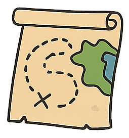
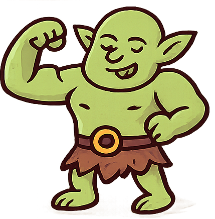
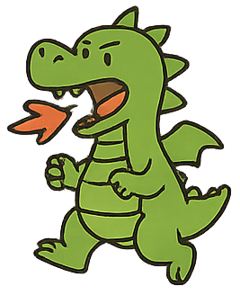
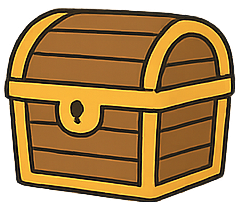
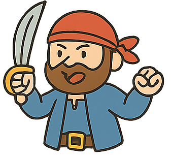
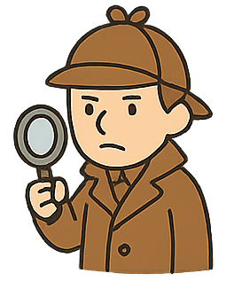
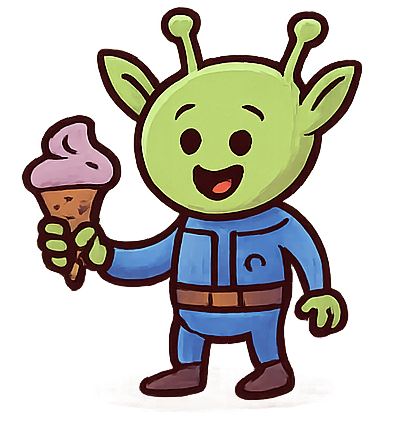

# GitForTeamStory24

This is the starting draft of your team's story. Your mission: revise and improve it, making it coherent, funny, and illustrated with the provided images.

---

## A Chaotic Story

1. Once upon a time, a **scientist** was 
   experimenting with instantaneous teleportation,    
   but the experiment went wrong when a **cat** accidentally wandered in and disrupted the system.
   
   

2. The resulting explosion of sparks ripped a hole in reality itself, and when the smoke cleared, the lab was gone — replaced by the stone walls of a castle that definitely hadn't been there five seconds ago. 
   

3. Standing in the courtyard was a knight, who took one look at the scientist's lab coat and the cat sitting on his shoulder and declared, "A wizard and his familiar! Finally, someone to break the castle's curse!" 
   
   
4. The scientist tried to explain this was a teleportation accident and he was not, in fact, a wizard — but the actual wizard who lived in the tower was far too busy arguing with his own reflection to clarify anything.
   
   
5. Desperate for real answers, they found an old map nailed to the castle door, with a note scrawled across it: "Curse ends when treasure is found. Good luck. —Management"
   
   
6. Following the map led them straight into a cave where a territorial ogre was guarding the entrance, furious that yet another group had tracked mud across his nicely organized rock collection.
   
   
7. Just as the ogre raised a boulder to throw, a dragon swooped down — not to attack, but to complain that the ogre kept stealing his firewood, and the two launched into an argument that had clearly been going on for years.
   
   
8. The cat, unbothered by any of this, calmly walked past the squabbling duo and pawed open a hidden door, revealing the small treasure chest everyone had been looking for.
   
    
9. Inside was nothing but a single key and a note: "Real treasure is bigger. Try not to die. —Management" The scientist sighed, now fairly convinced "Management" was the actual villain of this story.
    
    
10. The key fit a door deeper in the cave, behind which sat the large treasure chest, humming faintly with an energy suspiciously similar to the scientist's broken teleporter.
    
    
11. Guarding it was a ghost, who introduced himself as the castle's original owner and explained, quite cheerfully, that he'd been dead for 200 years and was thrilled to finally have visitors who weren't the ogre.
    
    
12. Before anyone could open the chest properly, a pirate crashed through the ceiling shouting that the treasure was rightfully his, having apparently been chasing this exact map since the 1700s.
   
    
13. As the pirate and the knight began arguing over ownership, a detective appeared from the shadows and calmly pointed out that the chest had been teleported here by the scientist's machine in the first place — meaning, legally, it belonged to the cat.
   
    
14. Just as everyone turned to stare at the cat, the chest burst open on its own, releasing a blinding light — and out stepped an alien, mildly annoyed that its "treasure tracking device" had accidentally summoned an entire medieval castle instead of retrieving a snack.
    
    
15. In the ensuing panic, the scientist finally got his teleporter working again — just in time to shove everyone, ghost included, onto a stolen rocket and blast off into space, leaving the ogre and dragon still arguing over firewood back on Earth.
    
    
16. Nobody really knows where the rocket landed. But wherever it was, the cat was definitely in charge.
    
The End. (For now.)
