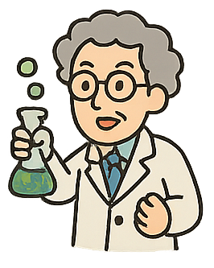

# GitForTeamStory24

his is the starting draft of your team’s story.  
Your mission: **revise and improve it**, making it coherent, funny, and illustrated with the provided images.

---

## A Chaotic Story

1. Once upon a time, a **scientist** was 
   experimenting with instantaneous teleportation,    
   but the experiment went wrong when a **cat** accidentally wandered in and disrupted the system.
   
   

2.

3.

4.

5.

6.

7.